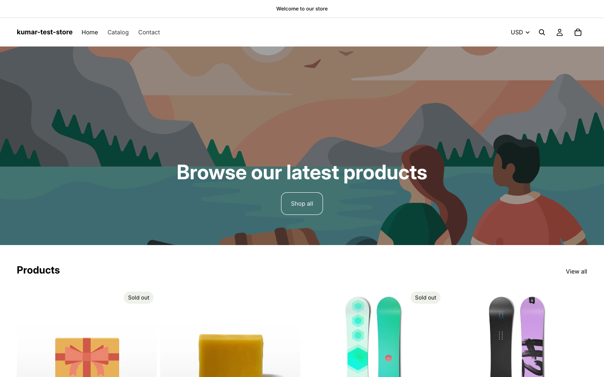
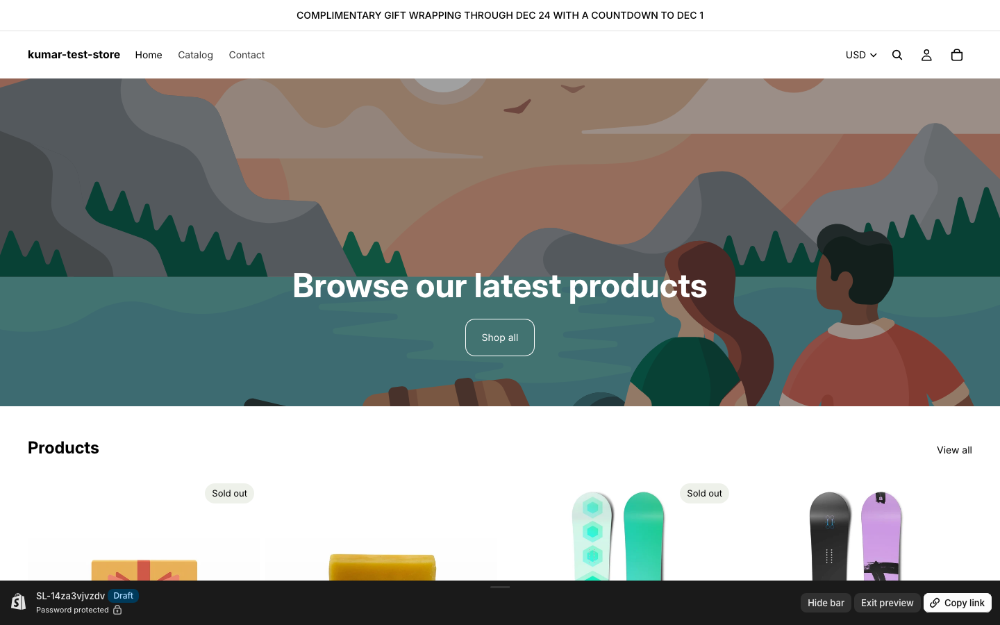

# StoreLoop

A ClickUp task tells StoreLoop what to build. StoreLoop does the Shopify work on a copy nobody
can see yet — an unpublished theme, or a dry-run admin plan — and posts a preview back to the
same task for a human to approve or correct. Nothing goes live until someone on your team moves
the card. Built for a Shopify Plus agency running retainer work through ClickUp.

## See it run

A real run on a Shopify dev store: the card was moved to "agent queue", the agent edited an
unpublished theme, and a revision comment ("make it uppercase") produced round 2. Live theme
untouched; Lighthouse mobile 61 → 99.

| Live theme (before) | Unpublished preview (after) |
|---|---|
|  |  |

2-minute walkthrough video: [docs/storeloop-walkthrough.mp4](docs/storeloop-walkthrough.mp4)

## 60-second architecture

A ClickUp webhook (task moved to "agent queue", or a comment on a task in "review") hits a small
Hono server, which verifies it and drops a row in a SQLite job queue. A worker loop in the same
process picks the job up, runs a Claude agent against the task — editing an unpublished Shopify
theme, or planning (never executing) an admin change — and posts one comment back to ClickUp with
a preview link, screenshots, and Lighthouse before/after. The agent never holds Shopify's Admin
API token and is blocked, at the tool level, from ever running `theme publish`; only the
orchestrator can do that, and only after the task is moved to "approved." Full diagram and the
reasoning behind each piece: [docs/ARCHITECTURE.md](docs/ARCHITECTURE.md) and
[docs/adr/](docs/adr/).

## Setup from zero

1. Prerequisites: a Shopify Partner dev store, Horizon theme
   **published live**, a custom app with an Admin API token (`read_products, write_products,
   read_themes, write_themes, read_online_store_navigation, write_online_store_navigation`), the
   Theme Access app installed, a ClickUp workspace with a `Clients` space and a `storeloop-demo`
   list carrying six custom statuses (`agent queue`, `agent working`, `review`, `approved`,
   `live`, `blocked` — ClickUp's API can't create these, add them by hand in the list's status
   settings).
2. `cp .env.example .env` and fill it in. **Nothing here costs money.** Optional keys:

   | Variable | Needed for | Default behaviour if empty |
   |---|---|---|
   | `STORELOOP_AGENT` | `demo` (rule-based, no LLM, free) or `claude` (real Claude agent) | `demo` |
   | `ANTHROPIC_API_KEY` | `claude` mode only; leave empty to use the Claude Code CLI login | not used |
   | `SHOPIFY_ADMIN_API_TOKEN` | admin tasks (tag/collection/redirect plans) and `seed-products` | theme tasks still work; admin tasks post a clear "token not set" blocker |
   | `STOREFRONT_PASSWORD` | dev stores can't disable their password page; this lets screenshots and Lighthouse past it | previews show the password page |

   `SHOPIFY_CLI_THEME_TOKEN` is the Theme Access password; `SHOPIFY_ADMIN_API_TOKEN` is the custom
   app's install token, not the OAuth client secret.
3. Optional: `npm run seed-products` adds 12 sample products (via the Admin API if the token is set,
   otherwise it writes `data/products.csv` for Shopify's Products → Import). Dev stores usually
   already ship with sample products.
4. `npm ci`
5. `npm run dev` — starts the Hono server + worker on `PORT` (default 8787).
6. In another terminal: `cloudflared tunnel --url http://localhost:8787`, then
   `npm run register-webhook -- storeloop-demo https://<tunnel-host>/webhooks/clickup` to point a
   real ClickUp webhook at your tunnel.
7. `npm run seed-tasks` to create the two demo ClickUp tasks, or just move an existing task in
   the `storeloop-demo` list to "agent queue."
8. `npm test` for the suite; `npm run demo-reset` resets Shopify + ClickUp demo state so you can
   reset the demo state.

## Demo script

1. Move the theme task to "agent queue." StoreLoop sets it to "agent working," then posts a
   preview link, before/after screenshots, and Lighthouse scores, and moves it to "review."
2. Comment a revision ("make it sticky on mobile only"). A second round lands on the same
   unpublished theme — the live storefront never moved.
3. Move the task to "approved." StoreLoop publishes that exact approved version and posts
   confirmation with the previous live theme's id, kept for one-click rollback.
4. Move the admin task to "agent queue." StoreLoop posts a dry-run plan — mutation list, affected
   count, a sample — before anything executes. Approve it; StoreLoop executes the allow-listed
   mutations and writes `runs/<taskId>/rollback.json`.
5. Open `/runs` (basic auth) to show the audit timeline, including any command the agent tried
   that policy denied.

## Guardrails

| Guardrail | How it's enforced |
|---|---|
| Agent can't see the Admin API token | `SHOPIFY_ADMIN_API_TOKEN` is read only by `src/shopify/admin.ts`, never passed to the agent process |
| Agent can't publish a theme | `theme publish` has one call site (`src/shopify/publish.ts`), gated on ClickUp status `approved` and a matching plan hash |
| Agent's shell commands are filtered | `canUseTool` denies `--allow-live`, `theme publish`, `theme delete`, `rm -rf`, `curl`, `wget`, `git push`, and any path outside the task workspace — before the command runs |
| A stale approval can't go live | The plan hash approved is snapshotted at approval time; if a revision lands first, publish/execute refuses and asks for re-approval |
| Admin agent can't do anything destructive | Its plan schema only has five allow-listed mutation types — delete/price-change ops can't even be expressed in its structured output |
| Every webhook is verified | HMAC-SHA256 against a per-client secret, constant-time compared; unverified requests never create a job |
| StoreLoop never re-triggers itself | Every comment it posts starts with `[StoreLoop]`; such comments are ignored by the webhook router |
| Nothing is lost on failure | Every job is a durable SQLite row; failures end in `blocked`/`failed` with the reason posted to the task, not a silent drop |

## Adapter roadmap

`src/adapters/types.ts` defines the platform-agnostic interface (`plan` / `preview` / `apply` /
`rollback`). Shopify (theme + admin) is fully implemented, and the default `demo` agent runs the whole loop with no LLM; Storyblok, Sanity, Craft, Vercel, and
Netlify are typed stubs mapping the same loop to each platform's native preview concept — see the
comment on each stub for specifics.

## What this doesn't do yet

Checkout extensions, Shopify Functions, and destructive bulk edits (delete, price change) are out
of scope by design — the admin agent's plan schema structurally can't express them.

## Verification status

| Piece | Status |
|---|---|
| Webhook signing, dedupe, routing, queue, policy invariants | Unit + integration tests (90 passing, `npm test`) |
| Theme loop (queue → agent → unpublished theme → screenshots + Lighthouse → ClickUp comment → revision from a comment) | Run live against a Shopify dev store and a ClickUp workspace |
| Publish on "approved" | Covered by the end-to-end test with a mocked Shopify CLI; not yet run live |
| Admin plan / execute | Covered by tests against a mocked Admin API; needs `SHOPIFY_ADMIN_API_TOKEN` to run live |
| `STORELOOP_AGENT=claude` (real LLM agent) | Wired and tested with a mocked SDK; not yet run live. The default `demo` agent is rule-based |

## License

MIT
